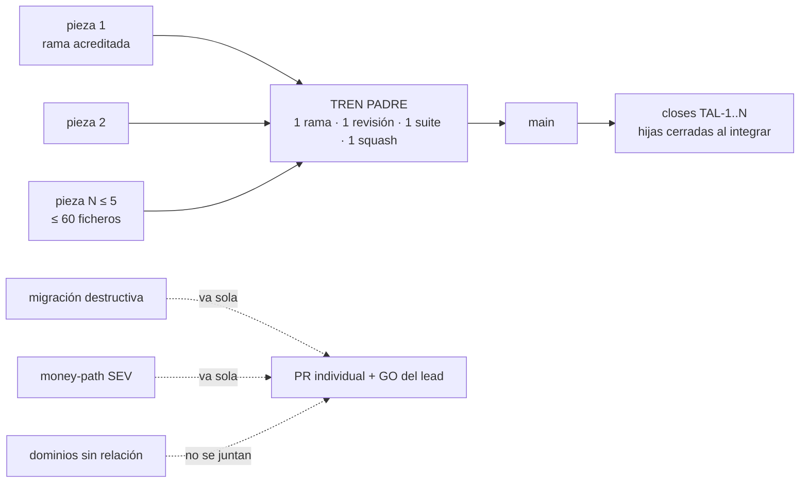
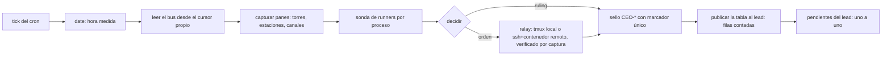
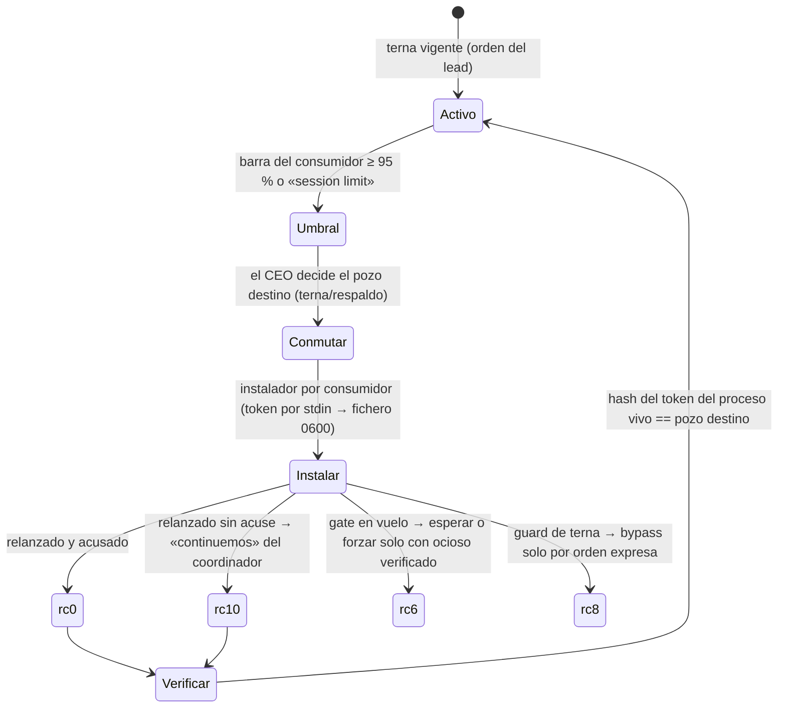

# Fábrica de agentes — flujos y cadencias

> **Serie «fábrica de agentes»**: [A · Modelo y players](fabrica-agentes-modelo-y-players.md) ·
> **B · Flujos y cadencias** (este documento) ·
> [C · Leyes operativas y glosario](fabrica-agentes-leyes-operativas.md) ·
> [D · Perfil de ejemplo Acme](fabrica-agentes-perfil-ejemplo.md).

## 1. Flujo de un cambio: de la issue a `main`

```mermaid
sequenceDiagram
  autonumber
  participant O as Orquestador
  participant C as Coordinador
  participant D as Canal (dev)
  participant A as Auditor (pane 1)
  participant PR as PR draft + HANDOFF
  participant M as Estación de merge
  participant R as Runners sellados
  participant MAIN as main / BD prod
  O->>C: orden de trabajo (encargo = 1..N issues cohesivas)
  C->>D: despacho (issue despachable, brief, modelo por fase)
  D->>A: plan → plan-gate
  A-->>D: acta GO/NO-GO anclada al SHA
  D->>A: código → code-gate (CERO×2: dos pasadas limpias, mismo head)
  A-->>D: acta GO ×2
  D->>PR: draft-handoff (gates locales verdes → sentinel) → push → PR draft + HANDOFF
  C->>PR: verify-handoff rc 0 tras converger la API (head_sha == headRefOid)
  C-->>M: cola de intake acreditada (bus)
  M->>PR: intake: HANDOFF + veredicto anclado; rebase solo si el churn cruza insumos
  M->>M: slots de migración contra el ledger real; revisión automática (CLI limpio autoriza)
  M->>R: suite sellada: 1 gate por invocación, receipts con journal
  R-->>M: receipts parciales
  M->>PR: agregación por contenido → commit-status local-gates
  M->>MAIN: squash-merge por verde real y ventana; cierre de hijas si es tren
  M->>MAIN: apply de migraciones no destructivas + advisors + ledger (mismo turno)
  MAIN-->>O: issue Done por `closes`; deploy automático desde main
```

Etapa a etapa, con su fuente de doctrina:

1. **Issue despachable** — cumple el núcleo de `talent-issue-craft` (decisiones selladas, DoD
   ejecutable, artefactos tocados, marcador de tipo); sin eso no hay encargo.
2. **Encargo y orden de trabajo** — el orquestador agrupa issues cohesivas en una rama y crea la
   orden en el proyecto de coordinación (`talent-orchestrator` refs 04, 08).
3. **Plan-gate y code-gate** — el auditor adversarial recibe el artefacto por relevo literal y
   devuelve un acta anclada al SHA; la entrega exige CERO×2 (`talent-channel-operation` ref 04).
   Un rebase mecánico conserva el GO; un cambio de contenido exige par nuevo.
4. **Entrega** — `draft-handoff` corre los gates locales y emite un sentinel atado al SHA; el push
   abre un **PR en borrador** con el comentario HANDOFF cuya única enumeración canónica es
   [`docs/templates/handoff-pr-draft.md`](../plantillas/handoff-pr-draft.md). `verify-handoff` se corre
   **después de que la API devuelva el SHA empujado**, nunca en el mismo instante del push.
5. **Intake** — la estación exige HANDOFF válido y veredicto anclado al head vivo; sin él, bounce
   sin gatear. Mide el rc del fetch antes de calcular la intersección del churn con sus insumos y
   **no rebasa por reflejo**: si la base sigue siendo ancestro y nada cruzó, re-mide solo lo cruzado.
6. **Slots** — las migraciones se renumeran contra el ledger real ∪ `main` ∪ PR abiertos; un slot
   con reserva del mando no se renumera; una renumeración byte a byte conserva el cuerpo, así que
   el contenido se re-verifica contra el estado de `main` en ese slot (`talent-merger` ref 06).
7. **Suite sellada** — el motor corre un gate por invocación en un runner sin credenciales y emite
   un receipt con SHA y journal; los receipts se cuentan **por contenido** (base_tip == `main` vivo
   o ancestro con insumos no tocados), nunca por número de ficheros; un receipt sin journal de
   procedencia no es agregable ([local-gates](runbooks/local-gates.md)).
8. **Merge** — squash por verde real (37 gates al corte) y ventana; si es un tren, las hijas se
   cierran como «superseded por el padre» **en el mismo acto** de integrar, con contención línea a
   línea de sus añadidos.
9. **Apply** — migraciones no destructivas en el mismo turno con advisors y fila del ledger;
   destructivas solo con GO del lead (regla 24 de CLAUDE.md).

## 2. Variante: tren padre



Un lote cohesivo de 2+ encargos del mismo dominio va por tren: las piezas entregan **rama** (no
draft por pieza), la estación las integra en un PR padre con un commit por pieza (verificable en el
log del padre) y atesta con `patch-id` que la aportación no cambió; un patch-id distinto solo por
contexto no prueba comportamiento: lo prueba `unit`. Cota: ≤ 5 piezas y ≤ 60 ficheros por sub-tren
(`talent-merger` ref 09). Un tren cuyo head sea el de una hija vieja arrastra sus defectos: se
verifica por fichero, no por nombre.

## 3. Estaciones de merge en paralelo

Con N estaciones y N juegos de runners, las **suites corren en paralelo** y solo los **merges se
serializan** por el bus. Reglas:

- **Ventana al primero en verde real**: no hay turno fijo. La ventana la puede conceder el mando a
  una estación concreta (p. ej. para cerrar una cadena de churn) y **se respeta aunque otra tenga
  verde**; fundir dentro de la ventana ajena es infracción aunque no cause daño.
- **Batching por disjunción**: tras un verde posteado, toda pieza con base ancestro de `main` y
  ficheros disjuntos del churn acumulado se funde en la misma ventana de 15 min sin re-suite; solo
  se re-mide lo cruzado de verdad. La **suite nocturna completa** sobre `main` es la red que caza
  lo que la disjunción de ficheros no ve (disjunción de ficheros ≠ disjunción de comportamiento);
  rojo nocturno = incidente y batching suspendido.
- **Registros compartidos rompen la disjunción**: dos ficheros de registro con append (el runner de
  guards y el manifiesto de pgTAP) meten a la mayoría de los PR en un solo cluster; la salida es el
  registro por fragmentos (un fichero por pieza), sin el cual no hay intake.
- **Estación sin bus**: escribe un fichero de estado en su contenedor y el CEO transcribe el sello.
- **Lanzadores desacoplados**: la suite se lanza con `nohup`/`setsid`; sobrevive al relanzamiento
  de la sesión (cambio de cuenta, compact). Al volver, la estación **censa por contenido** y
  relanza solo lo que no tiene receipt válido; nunca dos drivers sobre la misma cola.
- **Techos**: cada máquina tiene un techo de gates pesados y el host una carga máxima para e2e; una
  suite lanzada no se mata por reprioridad, solo por carga o por cruce real.

## 4. Cadencias

| Cadencia | Minutos | Contenido |
|---|---|---|
| **Tabla de los mergeadores** | :06 · :21 · :36 · :51 | Una fila por estación: pieza, estado medido en su pane, gates vivos en sus runners (sonda por proceso), orden ejecutable si está ociosa. «Suite en curso» sin proceso en runner = incidente. |
| **Tabla de coordinadores y canales** | :13 · :28 · :43 · :58 | Tres torres + un canal por fila: pieza, señal viva por forma (tiempo entre paréntesis), modales, relays fantasma, ociosos > 30 min → orden al coordinador. |
| Parte de guardia | minuto fijo de cada hora | Salud del producto, dinero, observabilidad, atención; desviación reconocida si llega tarde. |
| Nocturna | 03:00 | Suite completa sobre `main`. |
| Tren de versiones | semanal | «Siempre en la última estable»; cuando sube el `engines` del producto, canales, golden y runners suben en la misma orden. |
| Barrido de torre | ≤ 5 min | Cada coordinador: panes, actas frescas (mtime), ociosos, cuota. |

Las dos tablas van **desfasadas 7,5 min**, se publican **enteras y por separado**, con las filas
contadas antes de enviar, y persisten a compacts y cambios de cuenta: sus crons se re-crean en el
paso-0.

## 5. Ciclo de una tabla del CEO



Reglas del ciclo: hora **solo** con `date`; el composer de un pane que muestra texto tenue es un
borrador del arnés, no una orden; un relay se da por entregado cuando la captura muestra la
cabecera enviada; un sello de resultado («fundido», «aplicado») solo se escribe tras re-medir por
API; una orden destructiva lleva sujeto (PID → padre → cgroup).

## 6. El bus

- **Formato**: cabecera `MARCADOR — resumen con hora medida`, cuerpo en Markdown, cierre automático
  con la hora medida por el sellador. Familias de marcadores por actor: `CEO-*`, `C1-*`, `C2-*`,
  `C3-*`, `M1-*` … `Mk-*`, `CHnn-*`.
- **Escritura**: solo por el sellador (lock, hora medida, anti-duplicado por la estampa exacta del
  marcador, anti-self-append). Los tokens de pre-claim/claim del merge son los de `talent-merger`
  ref 01 §2.
- **Lectura**: cada lector avanza su propio cursor; el CEO lee el bus en cada tick y acusa los sellos
  que le implican. Un marcador citado pero no publicado es un aviso, no un sello.
- **Quién habla por quién**: los coordinadores publican por sus canales; los relays a estaciones los
  hace solo el CEO; los canales rara vez escriben.

## 7. Pozos: cuentas en operación



- Las torres y estaciones se relanzan **por PID** con `--resume`/`--continue` y el token explícito
  (la cuenta logueada en el host no manda; el token del proceso sí); las estaciones remotas leen el
  token de un fichero 0600 en su contenedor.
- El uso se mide **por consumidor en su barra** (ventana corta y semanal con su reset), no por un
  lector del host; el reparto se verifica por hash del token en `/proc/<pid>/environ`.
- Vigilancia: un vigía por cuota dispara al 99 % o ante el texto de límite; el CEO conmuta, nadie
  por su cuenta. La terna la decide el lead y se registra con hora.

## 8. Relevo de sesión: compact, banco y paso-0

Toda sesión de larga duración compacta al 60 % de contexto en un **checkpoint limpio** (sin gate
propio en vuelo, sin edición a medias, sin modal), tras escribir un **fichero de regreso** fuera del
repo y verificarlo (`talent-context`). El CEO numera los suyos (`b<N>`) con un marcador de fin. El
**paso-0** al volver:

1. `date`; leer el banco entero; leer el bus desde el cursor.
2. Comprobar y re-crear los crons de las dos tablas.
3. Publicar el sello de paso-0 y la tabla que toque por reloj.
4. Medir estaciones y torres en el orden del banco; re-armar vigías y verificar por PID.
5. Pendientes del lead uno a uno.

Un canal compactado sin paso-0 ni orden está parado; una medida heredada del banco no autoriza a
contradecir una orden posterior: se re-mide la fuente vigente.

## 9. Instrumentos

| Instrumento | Dueño | Qué mide o hace |
|---|---|---|
| Sellador del bus | todos | Escribe un sello con hora medida, lock y anti-duplicado |
| Lector del bus con cursor | cada actor | Avanza el cursor propio y lista marcadores nuevos |
| Ronda de canales | CEO | Captura pane 0 y pane 1 de torres y canales; estado del composer (vacío, borrador, real) |
| Sonda de runners | CEO, estaciones | Gates vivos por `run_group` en cada runner de cada máquina |
| Aplicador de migraciones | estación o CEO por delegación | DDL + fila del ledger en una transacción; guard de nombre y de destructivas; advisors después |
| Consulta de solo lectura a prod | CEO, guardia | SQL por la API de gestión, sin escribir |
| Vigías | quien los arma | Emiten por transición; se verifican por PID tras cada relanzamiento |
| Instaladores de token | CEO | Conmutan un consumidor de pozo y lo relanzan; rc 0/6/8/10 |
| Motor de gates | estaciones | `run-gate-sealed`, `seal-suite`, `post-local-gates` en el repo motor |
| Verificador de entrega | canal, coordinador, estación | `verify-handoff` fail-closed contra la API |

Los instrumentos del mando se versionan en el skill del CEO (ver C y las issues de skills de la
instancia en D); los del motor viven en el repo hermano de la fábrica.
