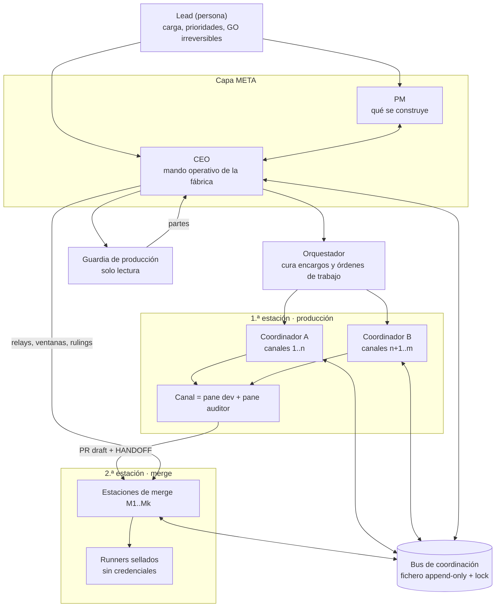

# Fábrica de agentes — modelo y players

> **Serie «fábrica de agentes»**: **A · Modelo y players** (este documento) ·
> [B · Flujos y cadencias](fabrica-agentes-flujos-y-cadencias.md) ·
> [C · Leyes operativas y glosario](fabrica-agentes-leyes-operativas.md) ·
> [D · Perfil de ejemplo Acme](fabrica-agentes-perfil-ejemplo.md).
>
> A, B y C son **independientes del repositorio y de la máquina**: describen el modelo tal como se
> ejecuta con los skills del paquete de fábrica. Los nombres reales de máquinas, contenedores,
> sesiones y cuentas viven **solo** en D.

## 1. Qué es una fábrica de software con agentes

Una fábrica es una organización de **agentes de software** que convierte issues de un tracker en
cambios fundidos en `main` y desplegados, **sin que una persona teclee código ni apruebe cada paso**,
pero con más controles de los que una revisión humana típica aplica. La persona (el *lead*) fija
la carga, las prioridades y las decisiones irreversibles; el resto es ejecución agéntica con
evidencia medible en cada frontera.

El modelo separa la producción en **dos estaciones** con credenciales distintas
([ADR-0043](decisions/0043-fabrica-v2-mergeador-posture-cr.md)):

- La **primera estación** (canales de producción) lleva un encargo desde el plan hasta un **PR en
  borrador** con un comentario **HANDOFF** que declara qué se entrega, con qué evidencia y qué
  gates ya se corrieron. Un canal **nunca** fusiona.
- La **segunda estación** (estaciones de merge) consume esos borradores: verifica el HANDOFF, corre
  la revisión automática de código y la **suite sellada de gates** en runners sin credenciales, y
  ejecuta el squash-merge y las migraciones post-merge. Es la única que fusiona.

Encima de las dos estaciones hay una **capa de mando** (CEO, PM, orquestador, coordinadores,
guardia) que reparte trabajo, mide y decide, y por debajo una **planta física** (contenedores,
runners, cuentas de los proveedores de modelos) que se aprovisiona con el skill
[`talent-channels`](../skills/talent-channels/SKILL.md).

## 2. Principios que sostienen el modelo

| Principio | Qué significa en la práctica | Dónde se hace cumplir |
|---|---|---|
| **Anti-self-report** | Nadie declara verde lo que no ha medido sobre ese SHA exacto; el receipt de un gate lleva el SHA y el journal de procedencia. | `local-gates` (runbook [local-gates](runbooks/local-gates.md)), regla 12 de CLAUDE.md |
| **Fail-closed** | Ante una lectura ambigua o un instrumento que no arranca, el veredicto es «no medido», nunca «verde». Un rc distinto de 0 es INCUMPLIDO. | verificadores (`verify-handoff`), agregador de gates |
| **Separación por credenciales** | Los canales no tienen la clave de la revisión automática ni del tracker de despliegue; los runners no tienen ninguna credencial. | perfiles de canal en `talent-channels` |
| **Ventana al primero en verde real** | El merge no va por turno fijo: lo toma la estación que llega con la suite entera verde, respetando la ventana que el mando haya concedido. | doctrina del CEO (C, leyes de merge) |
| **Cero ociosidad** | Toda estación y todo canal tienen una tarea en curso verificada en cada tabla de cadencia; una fila ociosa es una orden ejecutable en el mismo turno. | tablas del CEO cada 15 min (B §4) |
| **Sujeto para lo destructivo** | Matar un proceso, borrar o aplicar una migración destructiva exige sujeto identificado (PID → padre → cgroup) y, si es irreversible en datos, el GO del lead. | regla 24 de CLAUDE.md; doctrina del CEO |
| **Lo durable va al tracker** | Decisiones, rulings y bounces se escriben en la issue o el PR; el bus es operativo, no archivo. | `linear-skill`, plantillas de issue-craft |

## 3. Jerarquía de mando



La jerarquía canónica de la capa META está en `talent-orchestrator` ref 11; este documento la
completa con lo que la práctica añadió: el **CEO** es el mando operativo único (relays a torres y
estaciones, tablas de cadencia, sellos, conmutación de cuentas, applies post-merge y rulings) y el
**PM** es la contraparte de producto. En una instancia pequeña una misma sesión puede ejercer varios
roles de la capa de mando (ver D); el modelo no cambia por ello.

## 4. Tabla central de players

| Player | Dónde corre | Cómo se le habla | Qué produce | Cadencia | Doctrina |
|---|---|---|---|---|---|
| **Lead** | Terminal propia, junto al CEO | Órdenes verbales en la terminal; una pregunta a la vez; respuestas del CEO en su idioma | GO/NO-GO irreversibles, rulings, cambios de cuenta, leyes | A demanda | CLAUDE.md reglas 9, 22, 24; C |
| **CEO** | Sesión de mando en el host, con acceso a todas las máquinas | El lead directo; él relaya a los demás por tmux (local) o ssh + contenedor (remoto) | Sellos `CEO-*` en el bus, dos tablas cada 15 min, órdenes de trabajo, applies, bancos de regreso | Tablas :06/:21/:36/:51 y :13/:28/:43/:58 (desfase 7,5 min); paso-0 tras cada relevo | `talent-ceo`; B §4-§5; C |
| **PM** | Sesión de la capa META (puede no tener pane propio) | Interfaz CEO⇄PM por el tracker | Intake priorizado, criterios de aceptación, dictámenes sobre entregas | Por ola/entrega | `talent-pm` |
| **Orquestador** | Sesión de mando (uno por fábrica/proyecto) | Órdenes de trabajo en el proyecto de coordinación del tracker | Encargos/bundles, cola priorizada del merge, registro de flota | Por batch; tren de versiones semanal | `talent-orchestrator` refs 05, 08 |
| **Coordinadores** | Una sesión tmux (**torre**) por grupo de canales, en el host | Relay del CEO por tmux; ellos relayan a sus canales con verificación pre-envío | GO de despacho, validación de entregas, actas de auditoría, censos de cola | Barrido ≤ 5 min; monitores re-armados tras cada relevo | `talent-channel-operation`; `talent-orchestrator` ref 09 |
| **Guardia de producción** | Torre de solo lectura en el host | Relay del CEO | Partes horarios (salud del producto, dinero, observabilidad), vigías por PID, escalados | Parte a minuto fijo de cada hora | `talent-coordination` ref 10 |
| **Canal (pane dev)** | Contenedor aislado por canal, pane 0 de su tmux | Solo su coordinador (relay verificado); el CEO **nunca** teclea en un canal | Commits, rama en origin, PR draft + HANDOFF, ficheros de veredicto | Por encargo | `talent-channel-operation` refs 01-04 |
| **Auditor adversarial (pane 1)** | Mismo contenedor, pane 1 | Relevo literal del pane 0 con delimitadores no confiables | Actas GO/NO-GO ancladas al SHA (plan-gate, code-gate, CERO×2) | Por gate | `talent-channel-operation` ref 04 |
| **Estaciones de merge** | Sesión tmux en el host o en máquinas satélite; una por juego de runners | **Solo el CEO** relaya a estaciones; ellas hablan por el bus con marcador | Intake, rebase y slots, revisión automática, suites, merges, applies, sellos `M*-MERGED` | Tabla :06/:21/:36/:51 | `talent-merger`; B §3 |
| **Runners sellados** | Contenedores sin credenciales, agrupados por máquina y asignados a una estación | Motor de gates lanzado desde la estación | Receipts parciales por gate con journal de procedencia | Por suite | `talent-channels` ref 08; motor `run-local-gates` |
| **Vigías y monitores** | Procesos del host o de la estación, por PID | Fichero o bus | Alertas por transición (actas frescas, ociosos, carga, cuota, tip de main) | Continuo; mueren con cada relanzamiento | `talent-context` ref 04; B §8 |
| **Bus** | Fichero append-only con lock en el host | `sellar` (escritura con hora medida) y lector con cursor por consumidor | Registro operativo de sellos con marcador único | Continuo | `talent-merger` ref 01 §2; B §6 |
| **Pozos (cuentas)** | Cuentas de los proveedores de modelos, rotadas por token largo | Instaladores del CEO; nadie conmuta por su cuenta | Capacidad de cómputo por ventana de cuota | Por umbral o por orden del lead | `talent-channels` ref 05; B §7 |

## 5. Ficha por player

Cada ficha resume mandato, límites, entradas y salidas. La doctrina completa vive en el skill citado.

### 5.1 Lead

Dueño del producto y de la fábrica. Da órdenes verbales por la terminal del CEO; decide cuentas y
cuotas, autoriza lo irreversible (migraciones destructivas, pagos, publicaciones) y convierte sus
correcciones en leyes. Puede **delegar su firma** en el CEO: un ruling reservado al lead lo cumple
un comentario del CEO con la fórmula de poderes delegados y la cita del log de terminal. Se le
presentan los pendientes **uno a uno**, nunca en lote (regla 22).

### 5.2 CEO

Mando operativo único. Lo que hace: leer el bus por cursor, medir estaciones y canales, relayar
órdenes (a torres por tmux; a estaciones remotas por ssh + contenedor + tmux), conceder y respetar
ventanas de merge, decidir rulings (slots, bounces, prioridades), conmutar cuentas con los
instaladores, aplicar migraciones post-merge cuando la estación no tiene token, publicar las dos
tablas y escalar al lead. Lo que **no** hace: teclear en canales (sus composers son borradores del
arnés), matar por patrón, firmar verdes que no ha medido. Se releva con un **banco de regreso**
numerado y un paso-0 fijo (B §8).

### 5.3 PM

Contraparte del CEO en la capa META: define **qué** se construye (intake, prioridad, criterios de
aceptación, dictámenes) y **no** manda sobre canales ni estaciones ni supervisa la ejecución en
vuelo: «el PM no puede ser un freno». Es la interfaz de producto con el lead; el CEO es la de
fábrica. Es parte del modelo aunque una instancia no le dedique un pane: entonces el CEO ejerce el
rol y lo declara en el perfil.

### 5.4 Orquestador

Uno por fábrica o proyecto activo. Cura **encargos** (bundles de 1-N issues cohesivas = una rama =
un PR draft), crea las órdenes de trabajo en el proyecto de coordinación del tracker, prioriza la
cola del merge y mantiene el registro de flota. No maneja canales ni fusiona. Abre el tren semanal
de versiones («siempre en la última estable»).

### 5.5 Coordinadores

Un coordinador por grupo de canales, operando desde una torre tmux. Despacha encargos, lanza rondas
de auditoría, cosecha actas **leyendo el disco del canal** (no pidiéndole que las relate), acredita
entregas con cuatro cosas medidas (ruta, hash, `head_sha == headRefOid`, línea literal del
veredicto) y una quinta (el auditor está trabajando o quieto, por captura), y mantiene un censo de
su cola de borradores con edad y último veredicto de intake. Cierra por el canal los modales del
arnés (encuesta → 0, cuota → «parar y esperar»). Concede **orden**, no instantes: el turno de carga
del host es de autoservicio (B §4).

### 5.6 Guardia de producción

Torre de solo lectura: vigila el camino del dinero, la observabilidad, el despliegue y la atención
al alumno; publica un parte a minuto fijo cada hora con desviación reconocida si llega tarde; sus
vigías corren por PID y se verifican contra `/proc` tras cada relanzamiento. No toca código, no
fusiona, no carga skills de operación de dinero salvo orden. Escala al CEO.

### 5.7 Canal de desarrollo (pane 0)

Un contenedor por canal con el repo clonado, un token por canal y dos panes. El pane 0 corre el CLI
del agente de desarrollo con el modelo del tier de coding (plan en el tier alto cuando el
coordinador lo conmuta). Recorre plan → plan-gate → código → code-gate → `draft-handoff` (gates
locales verdes → sentinel) → push → PR draft + HANDOFF → `verify-handoff` rc 0. Entrega **rama en
origin** o **PR draft**; nunca fusiona; nunca corre la revisión automática de la segunda estación.
Su composer es un borrador del arnés: solo su coordinador pulsa Enter (y el `/compact`).

### 5.8 Auditor adversarial (pane 1)

Gate independiente de plan y de código: recibe el artefacto por relevo literal con delimitadores no
confiables y devuelve un acta anclada al SHA. La entrega exige **CERO×2**: dos pasadas limpias sobre
el mismo head, sin mover el commit entre ellas; un rebase mecánico conserva el GO, un cambio de
contenido exige par nuevo. Sin acta anclada no hay intake.

### 5.9 Estaciones de merge

Tantas como juegos de runners haya. Cada una: pre-claim en el bus, intake (HANDOFF acreditado y
veredicto anclado al head), rebase **solo si el churn cruza sus insumos** (si la base sigue siendo
ancestro, se re-mide solo lo cruzado), renumeración de slots de migración contra el ledger real,
revisión automática (CLI limpio autoriza), suite sellada en sus runners, agregación de receipts por
contenido, post del commit-status, squash-merge por verde real y ventana, cierre de hijas en el
mismo acto si es un tren, apply de migraciones no destructivas con advisors y ledger en el mismo
turno. Habla por el bus; si una estación no tiene acceso al bus, escribe un fichero de estado y el
CEO lo transcribe. Sus lanzadores de suite van desacoplados de la sesión para sobrevivir a un
relanzamiento.

### 5.10 Runners sellados

Contenedores sin credenciales (ni tracker, ni proveedor, ni `.env.local`) donde el motor corre **un
gate por invocación** sobre un árbol fijado al SHA y emite un receipt parcial con journal. Se agrupan
por máquina y se asignan a una estación; cada máquina tiene un techo de gates pesados simultáneos y
el host una carga máxima para lanzar e2e.

### 5.11 Vigías y monitores

Procesos que emiten por **transición** (acta fresca, canal ocioso, carga, cuota, tip de `main`,
sellos ajenos en el bus). Mueren con cada relanzamiento de la sesión que los armó: el paso-0 los
re-arma y los verifica por PID. Un vigía que «no dispara» no prueba nada si nadie comprobó que
estaba vivo.

### 5.12 Bus

Fichero de texto append-only bajo `flock`, compartido por CEO, coordinadores y estaciones. Cada
escritura es un **sello** con marcador único (`<ACTOR>-<TEMA>-<HHMM>`) y hora medida por el propio
instrumento; el anti-duplicado se hace por la estampa exacta del marcador. Cada lector avanza su
propio cursor. Los cuatro tokens del pre-claim/claim de merge se definen en `talent-merger` ref 01.

### 5.13 Pozos (cuentas)

Las cuentas de los proveedores de modelos se operan como **pozos** con cuota por ventana: una terna
vigente decidida por el lead, un token largo por pozo en escrow (0600), instaladores que conmutan
un consumidor y lo relanzan en su sesión, y verificación por hash del token del proceso vivo. Nadie
conmuta por su cuenta.

## 6. Topología lógica

```text
HOST (mando + producción + parte del merge)
├── torres tmux: coordinadores A/B, guardia, estaciones de merge locales
├── contenedores de canal 1..n (pane dev + pane auditor)
└── runners sellados del host (juego de la estación local)

SATÉLITES (por ssh + contenedor)
├── máquina S1: estaciones de merge remotas + runners
├── máquina S2: runners
└── máquina S3: estación de merge remota + runners

TRANSVERSAL
├── bus (fichero + lock en el host; cursor por lector)
├── escrow de tokens y perfil de instancia (0600, fuera del repo)
└── motor de gates (repo hermano, canónico de los skills)
```

Reglas de la topología: cada estación tiene su **juego de runners** y no toma los de otra sin
avisar en el bus; cada máquina tiene un **techo de gates pesados**; el host tiene además una **carga
máxima** por debajo de la cual se lanzan e2e; y los turnos de carga del host se **autoconceden**
(el primero de la cola sondea la carga y entra cuando cabe), porque un turno concedido por relay
sobre un host que oscila en segundos nace caducado. Los nombres y números reales están en D.
